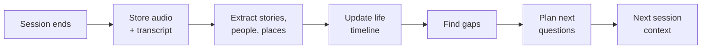

# Kataribe 語り部

**A voice AI that talks with an elderly person for a few minutes a day, and turns their memories into a life story their family can read and hear.**

A *kataribe* is a traditional keeper of oral history — the person who remembers the stories and passes them to the next generation. That is the job this does.

## For judges

**Try it: <https://kataribe.kaseovo.com>.** The start page makes you a persona of your own, so the interviewer talks with you about your own life, in English. It takes about three minutes:

1. Allow the microphone. The interviewer speaks first.
2. Talk as yourself. It follows where you go, one question at a time.
3. At two minutes it asks whether you want to go on. When you are done, say so or press **Finish**: it asks whether your family may read today's story. Answer aloud, or press **Share with my family** or **Keep it private**.
4. Your story appears on your own family page, with your voice behind each quote. Talk again, and it remembers.

The product itself is Japanese. The start page also links a family page from the demo, in Japanese with an English translation under each passage, and the [demo video](docs/demo/demo-script.md) shows a whole conversation with English subtitles.

Best in Chrome or Edge on a computer. Your conversation is recorded and processed by Gemini; your family page is reachable only by its link and shows only what you agree to share; the team can see full conversations to fix problems. Everything recorded from the start page is deleted once judging ends.

---

## Why

Many Japanese seniors spend a lot of time alone, and their families never find the time or the courage to ask about their lives. Having a professional write a 自分史 (self-history) costs upwards of ¥220,000 and happens once.

- **For the senior:** memory work, a sense of purpose, and the knowledge that their story will last.
- **For the family:** stories they never had time to ask about, and a reason to call and ask more.

## How it differs

- **Japanese, zero effort for the senior.** Nothing to install or learn: the interviewer speaks first. Today a Talk button; a tablet that notices them sitting nearby is on the roadmap.
- **Faithful by design.** Every passage links back to the real audio. The AI never speaks for the person and never invents a detail.
- **A family loop, not a companion.** Relatives read new stories and send back questions the AI asks next time. It is a bridge between people, not a replacement for one.
- **Affordable.** A self-history for every family, not a one-off for the few.

## How it works



The device is only a channel. The product is the loop: every conversation becomes structured memory, and that memory plans the next conversation.

## Stack

| Part | Tech |
| --- | --- |
| Kiosk + family view | React, Vite, TypeScript |
| Voice | Gemini Live API, native audio with built-in transcription |
| Backend | FastAPI (Python 3.13, uv) |
| Processing | Gemini text model — extraction, timeline, gap analysis, question planning |
| Storage | Firestore and Cloud Storage on Cloud Run (Tokyo); SQLite and local files in development |

## Getting started

Requires [uv](https://docs.astral.sh/uv/), Node 22+, and pnpm.

```bash
make install     # backend + frontend dependencies
make dev         # API on :8000, web on :5173
make check       # lint, types and offline tests — fast, no network
make eval        # streams real Japanese audio at the Live API — slow, costs quota
```

Set your Gemini API key before running a conversation:

```bash
cp backend/.env.example backend/.env   # then fill in KATARIBE_GEMINI_API_KEY
```

## Testing

`make check` is offline and runs on every push: config shape, endpoint validation, resampler maths.

`make eval` is the one that matters. It synthesizes Japanese speech, streams it at the Live API in real time through the same ephemeral-token path the browser uses, and checks what came back:

- the transcript matches what was said, names and places included
- the interviewer waits through a pause for thought, and cuts in when the patience setting is lowered
- the reply is Japanese, asks one thing, and follows the prompt's rules — graded partly by rules, partly by a model judging against the prompt itself
- the whole loop works in a real browser, with the microphone replaced by the sample

It runs on demand rather than on every push or every night, because it runs in real time and costs Gemini credit: by hand (Actions, *Eval*, *Run workflow*) after anything that changes how the interviewer speaks or listens, and before a release. It matters: the bugs that have actually bitten this project were configs that passed every offline check and died on a live socket.

`make spar` goes further and puts the interviewer in a live conversation with an AI playing the person being interviewed — three personas, each written to press a different rule in the interviewer's prompt. Both sides are real audio, so pauses and turn-taking are genuine rather than scripted.

A six-minute session test runs with it (`pnpm test:endurance`), because the interview lengths the product needs are several times longer than any other test here — and that gap once hid sessions dying after two minutes.

Note that the judge and the personas both consume API quota; the free tier's daily cap is low enough that a few full runs will exhaust it.

Synthesized speech is clean and evenly paced, so it proves correctness rather than robustness. Drop a real session recording into `backend/tests/live/recordings/` and the same harness will replay it.

## Project status

**Live:** <https://kataribe.kaseovo.com>. The start page and family pages are open to anyone with their link; the console, at `/console`, is behind a team password. See [docs/deploy.md](docs/deploy.md).

Prototype, built in the open over four weeks. See [docs/plan.md](docs/plan.md) for the full plan and [docs/roadmap.md](docs/roadmap.md) for what is built and what is next.

## Privacy

Recording starts only when the senior presses Talk. Stories stay private until the senior says, in their own words, that their family may read them, and those words are checked against the recording. A story can be taken back in any later conversation. Presence detection, which would run on the device and never send video anywhere, is on the roadmap, not in this build.

## License

MIT — see [LICENSE](LICENSE).
