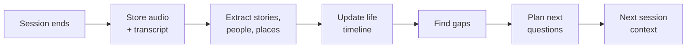
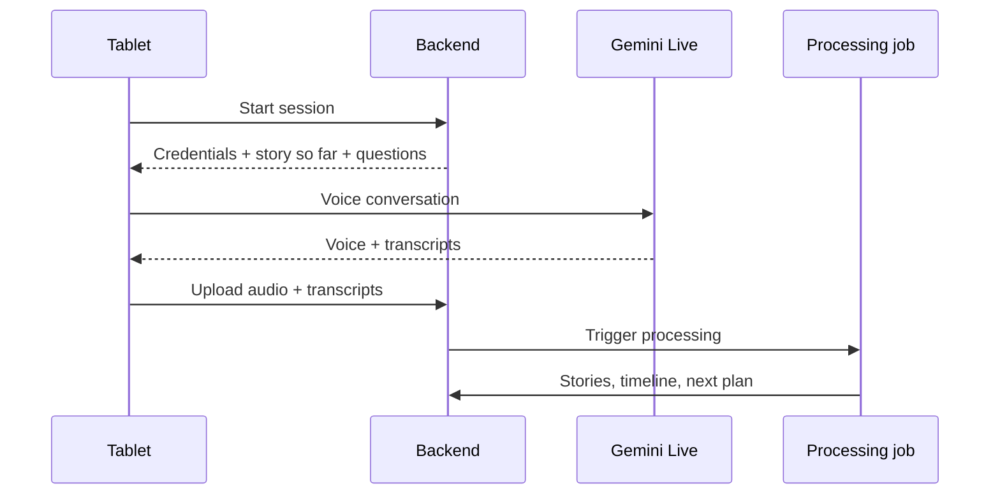

# Life-Story Interviewer: Implementation Plan

Last updated: 2026-10-10

## Overview

A voice AI talks with an elderly person for a few minutes a day and turns their memories into a life story the family can read and hear. The hackathon build runs on a tablet on a shelf; later channels plug into the same backend.

- **Who it's for:** Japanese seniors who spend a lot of time alone, with or without family nearby.
- **For the senior:** memory work, a sense of purpose, and the knowledge that their story will last.
- **For the family:** stories they never had time or courage to ask about, and a reason to call and ask more.
- **Hackathon scope:** the tablet channel, the interview brain, and a family view.
- **Out of scope for now:** bilingual output for families, the phone channel, hardware, printed books.

Problem statement fit: the Sustainability & Social Impact theme, whose brief lists supporting communities. See *Submission rules*.

## Positioning

AI memoir interviewers are crowded, and one of them now works in Japanese. [Tell Mel](https://tellmel.ai/) phones a parent on a schedule, holds an adaptive interview in any of ten languages including Japanese, and turns each call into a chapter with its audio. "The first AI self-history (jibunshi) interviewer in Japanese" is not a claim we can make. The pitch rests on what the others, going by their own pages, do not do.

**They lead. The AI plans what to ask. The family can join.**

Checked 2026-10-10. Most of what is known about these products comes from their own pages.

| Product | Where | What it does | Why ours differs |
| --- | --- | --- | --- |
| [Tell Mel](https://tellmel.ai/) | 26 countries, 10 languages including Japanese | AI phones on a schedule for 20–30 minutes and asks its own follow-ups. The family sets topics and things to avoid at setup. Each call becomes a chapter rewritten in the narrator's voice, with the audio. $39–219 a year. | Chapters are rewritten, not quoted. The family decides who receives them. Family topics are set once, at setup. |
| [Remento](https://resources.remento.co/getting-started/4-minute-overview) | US | Weekly spoken prompts, from family or its own bank, turned into a hardcover book with QR codes to the audio | English; one prompt a week rather than a conversation |
| [Storyworth](https://welcome.storyworth.com/what-is-storyworth) | US | A weekly email prompt for a year; family picks or writes the questions; mostly written answers; a book | Written, prompt by prompt |
| [HereAfter AI](https://heapsmag.com/hereafter-storytelling-ai-voice-forever) | US | A virtual interviewer records stories; later the family asks questions and hears answers in the recorded voice | An archive to query, not a continuing interview |
| [Iloomi](https://apps.apple.com/app/id6467228839) | US | Conversational biographer that remembers across stories | English smartphone app |
| [MemoirTalk](https://apps.apple.com/app/id6772472931) | US | Voice companion with a map of life periods covered; family can read along | English iPhone app |
| [Memoirji](https://memoirji.com/blog/best-storyworth-alternatives-2026/) | Online | AI interviewer over WhatsApp chat in 10 languages; a PDF memoir | Text chat on a smartphone |
| [EchoMind](https://lablab.ai/submissions/h4rulvuwnisq0vddw32tct30) | Hackathon, June 2026 | Trauma-informed interview, then Gemini agents write chapters and a typeset PDF | Judges may have seen this shape already |
| [親の雑誌](https://oyanozasshi.jp/price/) (Kokoromi) | Japan | Human interviewer writes a printed family magazine, from ¥220,000 incl. tax | Expensive, done by hand, one-off |
| [Lifebook Maker](https://newscast.jp/news/0650416) | Japan | AI generates questions from birth date and place; answers are typed; free basic tier | Text only; voice is planned |
| [茶の間 Cotomo](https://thebridge.jp/2024/12/starley-developer-of-voice-ai-chat-app-cotomo-raises-additional-200-million-yen-total-funding-reaches-1-billion-yen) (Starley) | Japan | AI calls an elderly relative daily at a set time; family gets a short report. In a [Yokosuka City trial](https://aismiley.co.jp/ai_news/cotomo-starley-yokosukacity-talk-ai/) since April 2025, used to bring back memories against loneliness and dementia risk. | Companionship and reminiscence; no life story is produced, as far as published |

Differentiators, strongest first:

- **The person decides what is shared.** A story reaches anyone only if they agreed in their own words, and those words are checked against the recording. Topics they refuse are protected even from family questions. Tell Mel's page describes the family choosing who receives chapters, and no consent controls for the storyteller.
- **Faithful, not rewritten:** every quote is checked word for word against the transcript and linked to the audio; the AI never speaks for the person.
- **Built for Japanese, not translated:** honorific register, names spelled from the profile rather than guessed from sound, a pause tuned for elderly Japanese speech. This holds only once a native speaker has judged it.
- **A family loop that keeps going:** relatives send questions at any time, the interviewer says who is asking, and the answer links back to them.

Zero effort and price are no longer differentiators: Tell Mel needs only a phone and costs $39–219 a year. They stay product principles. Against 親の雑誌's ¥220,000, the price point still holds.

### Not everyone has family

The family loop is one way in, not the product. The interviewer plans its own questions from the gaps in the story, and family questions are optional, at most two a session.

That matters because many of the people this is for have nobody nearby: about 6.72 million people aged 65 and over lived alone in the 2020 census (confirm against the [Cabinet Office white paper](https://www8.cao.go.jp/kourei/whitepaper/w-2026/zenbun/pdf/1s1s_03.pdf) before quoting it). Living alone is not the same as having no family, but the group without close relatives is real and growing. For them:

- **The value is the same:** being listened to, memory work, a reason to look back. Reminiscence (回想法) is established in Japanese elderly care.
- **The audience is whoever they choose:** a friend, a care worker (a life history helps staff care for the person), a local archive, or nobody but themselves. A local archive is the original *kataribe*: the keeper of a community's stories.
- **Testimony, the oldest meaning of the word.** In Japan, 語り部 are the people who tell what they lived through, the war, the atomic bombings, disasters, and a local archive or museum could keep such accounts with the same faithfulness. Two things stand in the way, both after the deadline: sharing beyond the family needs the chosen audiences below, and the interviewer never presses on a painful memory, so an archive version lets the teller choose that topic and stop at any time. The video's closing line names it as what comes next.
- **The payer is the municipality.** Yokosuka's trial with Cotomo shows the interest. One vendor says preventive conversation AI can be funded from the 介護予防・日常生活支援総合事業 budget ([Tifana](https://www.tifana.ai/article/mimamori-2)); unverified.

For the hackathon the demo keeps the family loop, which shows best on camera, and the pitch says the family *can join*, not that it drives anything. After the deadline, sharing generalizes from "family" to a list of audiences the person chooses.

## Hackathon channel: the tablet on a shelf

A tablet stands in for the future home device: always on, set up once by family, nothing for the senior to open or tap.

- **Setup:** family installs the web app in kiosk mode (auto-launch, screen always on, plugged in). They enter the senior's name, preferred time of day, and a few seed facts such as birthplace and family names.
- **Presence detection:** on-device face detection (MediaPipe in the browser) notices someone sitting nearby. No video leaves the device or is stored, and nothing records until the senior agrees to talk.
- **Invitation:** at most once a day, near the chosen time, a greeting that recalls the last story and proposes one topic. Example: "Last time you told me about the textile factory. Could you tell me about your first boss?"
- **Backing off:** a "no" or no answer means silence until tomorrow.
- **Session:** 5 to 10 minutes of Gemini Live voice conversation, then a warm close that names a topic for next time.
- **Screen:** large text, the current topic, a clear stop button, and a visible listening indicator.
- **Fallback:** a large "Talk" button in case presence detection misses.

## The brain

The backend turns each conversation into structured memory and plans the next one. This is the real product; the device is only a channel.

Each session runs this loop once, after the conversation ends.

1. **Store:** save the raw audio and Gemini's native input and output transcripts per session.
2. **Extract:** an LLM pass pulls out stories. Each story gets a title, summary, people, places, approximate period, and the senior's own quotes with audio timestamps.
3. **Timeline:** place stories on life stages (childhood, school, work, marriage, children, later life). Approximate dates are fine.
4. **Gaps:** flag life stages with few stories, people mentioned but never described, and stories cut short.
5. **Plan:** rank 3 to 5 follow-up questions by gap size, and keep an avoid list of topics the senior declined.
6. **Context:** the next session's system prompt gets a short "story so far", the planned questions, and the avoid list.

## Family view

A simple web page for invited relatives shows the life story as it grows.

- **Chapters by life stage:** each story shows its summary and the senior's own quotes.
- **Audio everywhere:** every passage links to the original clip.
- **What's new:** stories added since the last visit are highlighted, e.g. "New: her wedding day."
- **Visibility:** only stories the senior agreed to share appear. Hackathon version: private or family; "after I'm gone" comes later.
- **Notifications (later):** a short message when a new story lands, as a prompt to call and ask more.

## Architecture and stack

FastAPI on Cloud Run is the hub; the tablet talks to Gemini Live for voice and to the backend for everything else.

| Component | Tech | Role |
| --- | --- | --- |
| Tablet client | Web app in kiosk mode, MediaPipe face detection | Presence, invitation, mic and speaker |
| Voice | Gemini Live API, native audio with built-in transcription | Real-time Japanese conversation |
| Backend API | FastAPI on Cloud Run | Session start, short-lived Live credentials, uploads, family view API |
| Processing | Cloud Run job triggered at session end, Gemini text model | Extraction, timeline, gaps, question planning |
| Structured data | Firestore | Profiles, stories, timeline, plans |
| Audio | Cloud Storage | Session recordings and story clips |
| Family view | Web page served by the backend | Chapters with audio |

One session end to end; the next session starts from the plan the job wrote.

Model: `gemini-3.8-live` — generally available, and the [documented default](https://ai.google.dev/gemini-api/docs/models) for low-latency voice agents. It handles 70+ languages with real-time voice-to-voice translation. `gemini-3.8-live-extended-thinking` is the GA alternative if the interviewer needs more reasoning mid-conversation, at the cost of latency.

Both models this plan originally weighed are now superseded: `gemini-2.5-flash-native-audio-preview-12-2025` and `gemini-3.1-flash-live-preview` are both still preview, and the 3.1 one is labelled legacy. Staying on a GA model removes the discontinuation risk the plan was worried about.

## Data model sketch

Seven Firestore collections cover the hackathon; audio lives in Cloud Storage and is referenced by path.

| Collection | Key fields |
| --- | --- |
| `seniors/{id}` | name, birth year, birthplace, preferred time, seed facts, family members |
| `sessions/{id}` | seniorId, started/ended at, audio path, transcript, processing status |
| `stories/{id}` | seniorId, title, summary, lifeStage, approxPeriod, people[], places[], quotes[{text, sessionId, startMs, endMs}], visibility, sensitive, versionOf, createdAt |
| `people/{id}` | seniorId, name, relation, storyIds[] |
| `plans/{seniorId}` | storySoFar, nextQuestions[], avoidTopics[], updatedAt |
| `family/{id}` | seniorId, name, email, lastSeenAt |
| `questions/{id}` | seniorId, askedBy, text, status (pending, held, asked), askedInSession, answerStoryIds[] |

`versionOf` links a retold story to its earlier telling, so both versions are kept.

## Conversation design and safeguards

The senior leads; the AI listens, remembers and never speaks for them.

- **Follow their lead:** planned questions are invitations. If they drift to another memory, go with it.
- **Difficult memories:** war, loss and old relationships are never pressed. "Let's not talk about that" adds the topic to the avoid list, and it returns only if the senior raises it.
- **Faithfulness:** stories are built from their words, with every passage linked to audio. The AI never invents details. Hiroshima's [testimony device](https://www.city.hiroshima.lg.jp/atomicbomb-peace/fukko/1021099/1042983.html) follows the same rule: it only replays survivors' recorded answers.
- **Changing stories:** never correct them. Keep both tellings, linked to their sessions.
- **Consent to share:** once, at the close, the interviewer names today's stories and asks whether the family may read them; a painful story is asked about on its own. Default is private until they say yes, and a story can be taken back in any later conversation.
- **Distress:** if the senior sounds upset, slow down, offer to stop, and end warmly. In the hackathon build, flag the session in the dev view.
- **Limits:** one invitation a day, 5 to 10 minute sessions.
- **Privacy:** face detection stays on the device; family access is by invitation only.

## Future channels

Every channel plugs into the same brain; only the front end changes.

| Channel | When | Notes |
| --- | --- | --- |
| Tablet on a shelf | Hackathon | Kiosk web app with presence detection |
| Phone or landline | After the hackathon | Needs a Japanese number (provider identity and address checks) and conversion of 8 kHz phone audio, which adds latency and may hurt recognition of older voices |
| Smart speaker | Later | Voice only; uses the speaker's own presence sensing where available |
| Companion robot | Vision | Runs inside robots families already buy; asks about the past during the day |

Phone is deferred because setup takes time, audio quality drops, and a live outbound call is awkward to demo.

Pitch line: "Today a tablet on the shelf; tomorrow inside the robots Japanese families already buy; the brain is the same."

## Internal tooling

Translation exists only for the team and the judges, not as a product feature.

- **English dev view:** every transcript, extracted story and chapter shown with an English translation, for debugging and quality checks without reading Japanese.
- **Session inspector:** per session, the context injected, gaps found, questions planned, and any distress flag.
- **Native-speaker review:** a Japanese speaker checks that chapters match what was actually said.
- **Demo subtitles:** English subtitles on the demo video so judges can follow the conversation.

## Build plan

Four weeks to the prototype deadline on 2026-10-18, with a real senior testing from week 2.

| Week | Dates | Milestone |
| --- | --- | --- |
| 1 | Sep 22–28 | Japanese Gemini Live conversation in the browser; FastAPI on Cloud Run issuing credentials; audio and transcripts saved |
| 2 | Sep 29–Oct 5 | Extraction, timeline, gaps and question planning; next-session context working; first session with a real senior |
| 3 | Oct 6–12 | Kiosk mode, presence detection and invitation flow; family view with audio; English dev view |
| 4 | Oct 13–18 | Second real-senior test and fixes; demo video with subtitles; pitch deck |

## Submission rules

The hackathon is the [AI Builder Cup 2026](https://aibuildercup.com/index.html), Google Cloud's JAPAC hackathon run by Hack2skill. Rules checked on 2026-10-10 against its [challenges page](https://aibuildercup.com/themes.html), [FAQ](https://aibuildercup.com/Faqs.html) and [terms](https://docs.google.com/document/d/e/2PACX-1vRm7ChZ6Ij9fG7uFDkxzUMpwgVeBmnQ6cMDnAIEEX84AiLBOOQ9cYbl3S5OzFBbcVb8TF55s-eVpiXb/pub).

| Rule | What it means here |
| --- | --- |
| Teams of 2 to 4; no solo entries; no roster changes after October 11 | Every commit so far has one author. A team must be registered by Oct 11. |
| A working live URL on Cloud Run, GCP or Firebase | Deploying is required, not optional. SQLite on Cloud Run's local disk does not survive a restart. |
| A demo video of 3 to 4 minutes, public on YouTube, Vimeo or Drive, that clearly shows the solution working. Outside the window risks a penalty or elimination, and one that does not show it working stops at the prototype step | Aim for 3:30. This replaced "strictly under three minutes", read on 2026-10-10, on 2026-10-15. |
| A public GitHub repository | Done: [kaseovo/kataribe](https://github.com/kaseovo/kataribe) is public and pushed. |
| A deck, as a PDF, covering the solution architecture and the business case | The deck has no business-case slide yet and lives as a hosted page, so it needs a PDF export. |
| All submission materials in English, code and documentation included | The interviewer prompts ship in Japanese, with English glosses alongside. |
| Only fresh work, started after the program launched on 7 Sept | The first commit is dated 2026-09-22. Keep the history as it is: it is the evidence. |
| Built mainly on Google Cloud, using Google AI models | Gemini Live and Gemini Flash qualify. AI Studio is listed as an accepted platform, so Vertex is not required. |
| Eligibility: 21 or older, working professionals, legal residents based in JAPAC, no students | One student on the team disqualifies the whole team. |

Theme: **Sustainability & Social Impact**, whose brief lists supporting communities. The submission also asks for a category: Healthcare, Education, Sustainability, Accessibility or Social Good. Each person can be on one team and enter under one problem statement.

Judging: technical merit and Gen AI use 40%, problem alignment and impact 25%, innovation and creativity 25%, user experience and design 10%. Special awards include Best use of Google Cloud AI tools and Best UI/UX.

Not stated anywhere: the timezone of the Oct 18 deadline, and whether the live URL must keep working through evaluation (Oct 19 – Nov 6). Assume it must, and submit by Oct 17.

## Open questions and risks

The biggest unknown is Japanese voice quality with older speakers, so test it in week 1.

Open questions:

- [x] ~~Which Live model: the GA 2.5 native audio or the 3.1 Flash Live preview?~~ Resolved 2026-09-22: both are superseded. Using `gemini-3.8-live`, which is GA. The earlier [language-switching regression](https://github.com/google-gemini/cookbook/issues/1262) was against a preview model; still worth confirming the language holds steady in the week-1 Japanese test.
- [x] ~~Check the chosen model's listed discontinuation date.~~ No discontinuation date published for the 3.8 GA line; revisit if we move to Vertex.
- [ ] Does `gemini-3.8-live` handle elderly Japanese speech well — dialect, slower pace, quieter voice? This is the week-1 test and still the biggest unknown.
- [ ] Which region hosts the Live API, Firestore and Cloud Storage for Japanese seniors' voice data?
- [ ] Who are the one or two seniors for testing, and when is the first session?
- [ ] How do the senior and family give and record consent to recording?
- [x] ~~Does a tablet web app demo meet the hackathon's submission requirements?~~ Resolved 2026-10-10: yes, provided it is deployed on Google Cloud with a live URL. See *Submission rules*.
- [x] ~~Is the team registered, with at least two eligible members, before the roster closes on October 11?~~ Confirmed on Hack2skill on 2026-10-11, the day the roster closed.
- [ ] Which timezone is the Oct 18 deadline in? Ask on the hackathon Discord.
- [ ] Which category to submit under: Social Good, Healthcare or Accessibility?

Risks:

- **Crowded category, and Tell Mel already works in Japanese:** lead with the person's control over sharing, faithfulness, and Japanese built in rather than translated. Not with the interviewer itself.
- **Seen as an AI companion:** show the family view and the "call her and ask more" moment in the demo.
- **Japanese quality hard to judge in-house:** native-speaker review was planned every week, then postponed on 2026-09-30 with testing continuing in French. A native speaker is now on the team, and the review happens with the demo take on Oct 14–15, covering every prompt change made since. Anything it finds has to be fixed and retaken in the time left.
- **Scope creep:** phone, printed books, robots and bilingual output stay out until after the deadline.

## Sources

- [親の雑誌 pricing](https://oyanozasshi.jp/price/)
- [茶の間 Cotomo, BRIDGE article](https://thebridge.jp/2024/12/starley-developer-of-voice-ai-chat-app-cotomo-raises-additional-200-million-yen-total-funding-reaches-1-billion-yen)
- [EchoMind hackathon submission](https://lablab.ai/submissions/h4rulvuwnisq0vddw32tct30)
- [Remento overview](https://resources.remento.co/getting-started/4-minute-overview)
- [Tell Mel](https://tellmel.ai/), [Storyworth](https://welcome.storyworth.com/what-is-storyworth), [HereAfter AI (Heaps)](https://heapsmag.com/hereafter-storytelling-ai-voice-forever), [Memoirji review](https://memoirji.com/blog/best-storyworth-alternatives-2026/)
- [Lifebook Maker and other Japanese life-review tools (Newscast)](https://newscast.jp/news/0650416)
- [Yokosuka City × Cotomo trial (AI Smiley)](https://aismiley.co.jp/ai_news/cotomo-starley-yokosukacity-talk-ai/) and [municipal AI watch-over (Tifana)](https://www.tifana.ai/article/mimamori-2)
- [Cabinet Office aging society white paper, 2026](https://www8.cao.go.jp/kourei/whitepaper/w-2026/zenbun/pdf/1s1s_03.pdf)
- [Iloomi](https://apps.apple.com/app/id6467228839) and [MemoirTalk](https://apps.apple.com/app/id6772472931) App Store pages
- [Hiroshima testimony response device](https://www.city.hiroshima.lg.jp/atomicbomb-peace/fukko/1021099/1042983.html)
- [Gemini 2.5 Flash Live API on Vertex AI](https://docs.cloud.google.com/vertex-ai/generative-ai/docs/models/gemini/2-5-flash-live-api)
- [Live API regression report](https://github.com/google-gemini/cookbook/issues/1262)
